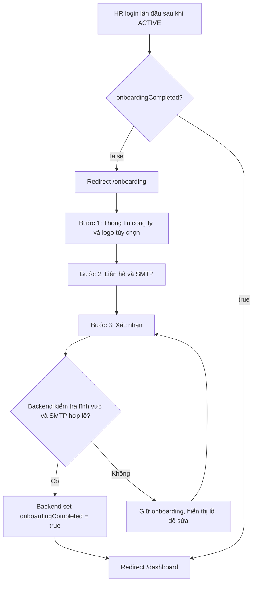

# 📋 User Story 03: HR Onboarding (Thiết lập Hồ Sơ Công Ty Sau Khi Được Duyệt)

## 1. MÔ TẢ USER STORY
- **Là** Nhà tuyển dụng (HR) vừa được Admin phê duyệt,
- **Tôi muốn** hoàn thành quy trình onboarding để thiết lập thông tin cơ bản cho công ty,
- **Để** hệ thống có đủ thông tin hiển thị trên Career Site và Dashboard, đồng thời tôi có thể bắt đầu tạo Job ngay sau đó.
- **Story Points:** 3

> Contract chốt lại 21/10/2026: giữ hành vi devHa. HR_ADMIN hoàn tất onboarding sau khi backend kiểm tra lĩnh vực và SMTP hợp lệ; không có Skip. `contactEmail`/`onboardingCompleted` là dữ liệu backend quản lý, không nhận trong request. Quyết định này thay mô tả Skip và email liên hệ nhập tay trước đây.

## SƠ ĐỒ LUỒNG NGHIỆP VỤ (Business Flow)

## 2. TIÊU CHÍ NGHIỆM THU (Acceptance Criteria)

- **Kịch bản 1: HR lần đầu đăng nhập sau khi được duyệt — bị redirect vào Onboarding**
  - **VỚI ĐIỀU KIỆN** Company.status = ACTIVE, User.status = ACTIVE, role HR_ADMIN và `onboardingCompleted = false`.
  - **KHI** HR đăng nhập thành công.
  - **THÌ** hệ thống tự động redirect về `/onboarding` thay vì `/dashboard`.

- **Kịch bản 2: Bước 1 — Xác nhận thông tin công ty**
  - **VỚI ĐIỀU KIỆN** HR đang ở Bước 1 Onboarding.
  - **THÌ** hệ thống pre-fill các trường từ dữ liệu đăng ký (Tên công ty, Email, Số điện thoại, Mã số thuế) — không được yêu cầu nhập lại.
  - HR có thể cập nhật thêm: Website, Ngành nghề, Quy mô công ty, Mô tả ngắn.
  - Quy mô mới dùng cùng danh sách US-02: `1-10`, `11-50`, `51-200`, `201-500`, `501-1000`, `1001+`. Legacy đã lưu chỉ được giữ nguyên; không bắt chọn lại để hoàn tất onboarding/sửa field khác và không tự remap.
  - HR nhấn "Tiếp theo" để sang Bước 2.

- **Kịch bản 3: Logo tùy chọn trong thông tin công ty**
  - **VỚI ĐIỀU KIỆN** HR_ADMIN đang ở bước thông tin công ty.
  - **THÌ** HR có thể upload Logo công ty (PNG/JPG, ≤ 2MB) — đây là logo dùng cho Career Site (public).
  - Nếu bỏ qua, hệ thống dùng placeholder mặc định.
  - HR nhấn "Tiếp theo" để sang bước liên hệ/SMTP, rồi bước xác nhận.

- **Kịch bản 4: Hoàn tất — Thông tin liên hệ và SMTP**
  - **VỚI ĐIỀU KIỆN** HR đang ở Bước 3 Onboarding (bước cuối).
  - **THÌ** HR_ADMIN xác nhận địa chỉ công ty, nhập email gửi thông báo và App Password. Backend kiểm tra kết nối SMTP trước khi lưu; không lưu/gửi lại mật khẩu dưới dạng plaintext.
  - `contactEmail` không có ô chỉnh riêng; backend lấy email tài khoản đăng ký nếu dữ liệu này đang thiếu, giữ email liên hệ legacy đã có. Đây không phải `mailEmail` gửi SMTP.
  - Nhấn hoàn tất → backend validate lĩnh vực, quyền/tenant và SMTP → backend set `onboardingCompleted = true` → redirect `/dashboard`.

- **Kịch bản 5: Thiếu lĩnh vực hoặc SMTP không hợp lệ**
  - Không có nút "Bỏ qua, thiết lập sau". Dữ liệu onboarding chưa đạt thì giữ nguyên cờ chưa hoàn tất, không đổi trạng thái Company/User và không redirect thành công.
  - Hiển thị lỗi có thể sửa/thử lại, giữ dữ liệu form. Logo/ảnh bìa, quy mô, slogan và giới thiệu vẫn tùy chọn; không bắt buộc tất cả trường hồ sơ.

- **Kịch bản 6: HR đã hoàn thành Onboarding — không bị redirect lại**
  - **VỚI ĐIỀU KIỆN** `onboardingCompleted = true`.
  - **KHI** HR truy cập lại `/onboarding`.
  - **THÌ** hệ thống redirect về `/dashboard`. Onboarding không xuất hiện lại.

## 3. BUSINESS RULES

### onboardingCompleted Flag
- `onboardingCompleted = false`: HR_ADMIN được điều hướng onboarding cho đến khi backend xác nhận lĩnh vực và SMTP hợp lệ. HR thành viên không được thay mặt HR_ADMIN lưu cấu hình công ty.
- `onboardingCompleted = true`: chỉ backend set sau cập nhật lần đầu thành công. Client gửi cờ hoặc `contactEmail` trả 400; không có thao tác Skip. Sau khi set true, chỉnh Settings không tự reset false.

### Dữ liệu pre-fill
- CompanyProfileDTO trả completedSteps/totalSteps/completionPercent/needsReminder; frontend hiển thị kết quả server, không tự tính trọng số khác. Hoàn tất onboarding không đồng nghĩa mọi trường tùy chọn đều đã đủ; logo/ảnh bìa vẫn tùy chọn.
- Onboarding KHÔNG được yêu cầu nhập lại dữ liệu từ bước đăng ký (Tên công ty, Email, MST).
- Dữ liệu từ bước đăng ký phải được pre-fill tự động qua API `GET /api/v1/companies/me`.

### Logo trong Onboarding
- Logo upload ở Bước 2 Onboarding → lưu vào `career_site_settings.logo_url` (public/Career Site logo).
- Logo nội bộ Dashboard (sidebar) có thể set riêng trong US-30 Company Settings.
- **Source of truth:** Career Site logo ← `career_site_settings.logo_url`; Dashboard logo ← `companies.logo_url` (nội bộ).

## 4. NGOÀI PHẠM VI
- **KHÔNG** yêu cầu mọi trường tùy chọn phải có dữ liệu; nhưng không hỗ trợ Skip để bỏ qua lĩnh vực/SMTP bắt buộc.
- **KHÔNG** reset `onboardingCompleted` về `false` khi HR chỉnh sửa thông tin sau đó trong Settings.
- **KHÔNG** có bước "Video giới thiệu hệ thống" trong MVP.
