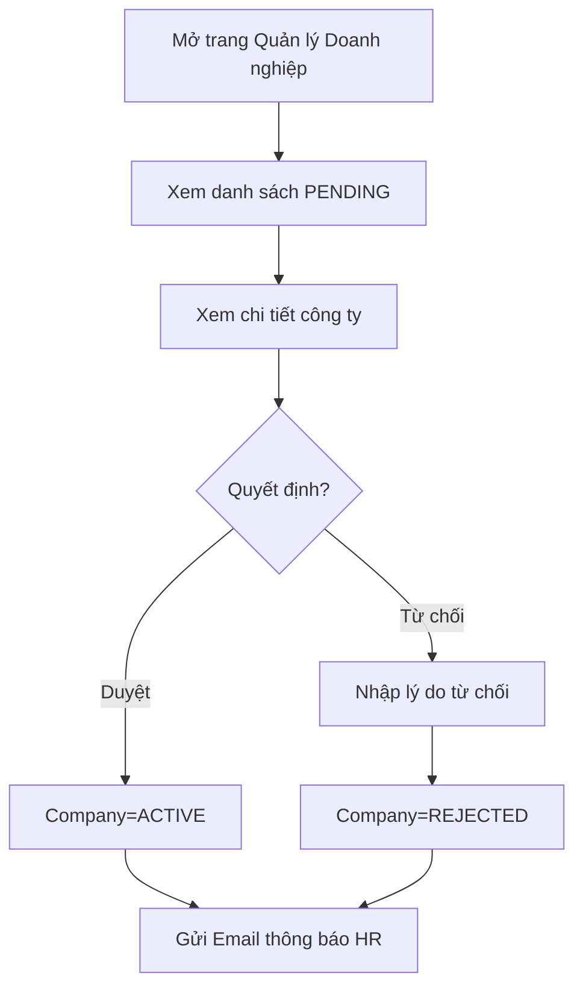

# 📋 User Story 06: Admin Duyệt Doanh Nghiệp (Approve Company Registrations)

## 1. MÔ TẢ USER STORY

- Quy mô khi sửa hồ sơ dùng lựa chọn chuẩn US-30 (`1-10`, `11-50`, `51-200`, `201-500`, `501-1000`, `1001+`). Admin được gửi lại đúng giá trị legacy hiện tại hoặc xóa trường tùy chọn, không đổi sang khoảng legacy khác. Không tự chuyển dữ liệu cũ.

### Đồng bộ email hệ thống ngày 21/10/2026

- Nội dung platform được quản lý tại catalog `SystemEmailTemplates`, không dùng template tuyển dụng do tenant sửa. Catalog trả plaintext; `enqueueSystem` escape HTML đúng một lần khi tạo snapshot. Tên công ty/lý do từ chối không trở thành HTML thực thi; link trả lại hồ sơ dùng `APP_PUBLIC_BASE_URL` tuyệt đối. Không đổi template code, số retry hoặc trạng thái outbox hiện có.

- Đăng ký, duyệt, từ chối, gửi lại và mở khóa Company ghi snapshot email hệ thống vào `email_logs` với `delivery_channel=SYSTEM` trong cùng transaction. Rollback nghiệp vụ cũng rollback email chờ.
- Worker chỉ xử lý sau commit, gửi bằng SMTP nền tảng, không dùng Gmail công ty chưa onboarding. Tối đa 4 lần tổng cộng (1 lần đầu + 3 retry); lỗi SMTP không rollback quyết định. OTP khôi phục mật khẩu vẫn gửi đồng bộ và báo lỗi gửi thật, không đổi sang queue.
- Email hệ thống, kể cả thông báo gửi Admin, không xuất hiện trong API email log ứng viên của HR và không được HR retry qua API đó. Nội dung tên/lý do từ chối phải escape trước gửi HTML.
- **Là** Quản trị viên Hệ thống (System Admin),
- **Tôi muốn** xem danh sách doanh nghiệp mới đăng ký và quyết định Approve hoặc Reject,
- **Để** chỉ những doanh nghiệp hợp lệ mới được cấp quyền sử dụng hệ thống và HR không bị rơi vào dead-end khi đơn bị từ chối.
- **Story Points:** 3

## SƠ ĐỒ LUỒNG NGHIỆP VỤ (Business Flow)

## 2. TIÊU CHÍ NGHIỆM THU (Acceptance Criteria)

- **Kịch bản 1: Admin xem danh sách công ty chờ phê duyệt**
  - **VỚI ĐIỀU KIỆN** Admin đang đăng nhập vào Admin Dashboard.
  - **KHI** Admin truy cập trang `/admin/companies/pending`.
  - **THÌ** hệ thống hiển thị danh sách các company có trạng thái `PENDING`. Thông tin gồm: Tên công ty, Email người đăng ký, Mã số thuế, Ngày đăng ký.

- **Kịch bản 2: Admin phê duyệt công ty thành công**
  - **VỚI ĐIỀU KIỆN** Admin đang xem chi tiết công ty chờ duyệt.
  - **KHI** Admin nhấn nút "Phê duyệt" (Approve).
  - **THÌ** hệ thống cập nhật `companies.status = ACTIVE` và `users.status = ACTIVE` cho tài khoản HR đăng ký.
  - Email thông báo được gửi đến HR: "Tài khoản của bạn đã được phê duyệt. Bạn có thể đăng nhập ngay.".

- **Kịch bản 3: Admin từ chối công ty**
  - **VỚI ĐIỀU KIỆN** Admin đang xem chi tiết công ty chờ duyệt.
  - **KHI** Admin nhấn nút "Từ chối" (Reject) và nhập lý do (bắt buộc).
  - **THÌ** hệ thống cập nhật `companies.status = REJECTED` và gửi email có lý do cụ thể cho HR.
  - Company bị ẩn khỏi danh sách pending và hiển thị trạng thái Rejected trong trang quản lý.

- **Kịch bản 4: Luồng bị từ chối không rơi vào ngõ cụt**
  - **VỚI ĐIỀU KIỆN** company đang ở trạng thái `REJECTED`.
  - **KHI** HR mở email hoặc xem trang Rejected.
  - **THÌ** HR thấy thông tin hiện tại, lý do từ chối, yêu cầu cần sửa, và CTA "Chỉnh sửa & gửi lại" cùng các tùy chọn hỗ trợ nếu cần.

- **Kịch bản 5: Kiểm tra trùng lặp thông tin**
  - **VỚI ĐIỀU KIỆN** một công ty chờ duyệt.
  - **KHI** Admin mở chi tiết.
  - **THÌ** hệ thống có thể cảnh báo nếu Mã số thuế hoặc Tên công ty tương đồng với company đang `ACTIVE`.

- **Kịch bản 6: Admin cập nhật trực tiếp Company Detail**
  - **VỚI ĐIỀU KIỆN** Admin đang mở drawer chi tiết một company.
  - **KHI** Admin chỉnh sửa và lưu các trường hồ sơ doanh nghiệp hoặc nội dung hiển thị Career Site.
  - **THÌ** hệ thống gọi `PATCH /api/v1/admin/companies/{companyId}`, kiểm tra subdomain và mã số thuế legacy còn thiếu, cập nhật trong đúng company và ghi Audit Log.
  - Mã số thuế đã được lưu và năm thành lập không được Admin sửa; hai trường này cố định từ lúc đăng ký, không phụ thuộc trạng thái duyệt hoặc lý do từ chối.
  - `profile.contactEmail` chỉ đọc với mọi vai trò, kể cả Admin. Backend lấy từ email tài khoản đăng ký khi thiếu, giữ giá trị legacy đã có; không cho client đổi, xóa hoặc tự bổ sung. Đây không phải email doanh nghiệp `company.email` hay tài khoản SMTP.
  - Trạng thái company, slug, thông tin người đăng ký, người duyệt và thời điểm duyệt vẫn chỉ đọc; Admin không được dùng API này để tự phê duyệt hoặc thay đổi quyền truy cập.

## 3. BUSINESS RULES

### Company & User Status Transitions
- **Duyệt:** Company = ACTIVE, User = ACTIVE (for all related HR accounts)
- **Từ chối:** Company = REJECTED, User = PENDING (restricted)
- HR thuộc company PENDING/REJECTED vẫn có thể đăng nhập, nhưng bị chặn truy cập workspace.
- Khi HR resubmit hồ sơ đăng ký đã bị reject: Company = PENDING, User = PENDING và hồ sơ quay lại danh sách Admin xem xét.
- Mở khóa BLOCKED → ACTIVE khác duyệt đăng ký lần đầu: giữ approved_by/approved_at và trạng thái từng thành viên (không kích hoạt tài khoản đã bị khóa riêng), ghi UNBLOCK_COMPANY, gửi nội dung thông báo mở khóa. UI có xác nhận Mở khóa.
- Resubmit trim trường văn bản và kiểm tra tỉnh/xã cùng cặp như đăng ký mới; không nối địa giới vào địa chỉ chi tiết. Email từ chối phải có URL tuyệt đối tới trang cập nhật hồ sơ, không dùng href tương đối.

### Rejection Policy
- Reject phải đi kèm lý do cụ thế, không để HR hiểu nhầm.
- Company REJECTED phải cho phép chỉnh sửa + gửi lại; không phải trạng thái ngõ cụt.
- Email từ chối phải bao gồm: cụ thể điểm không đạt, hướng dẫn sửa, CTA gửi lại hồ sơ.

### Registration Fields That Are Fixed
- `taxCode` và `profile.foundedYear` là thông tin bắt buộc của đăng ký mới và bất biến sau khi Company được tạo, với mọi role và mọi trạng thái.
- Lý do từ chối không mở ngoại lệ để thay đổi hai trường này. HR có thể giữ nguyên chúng khi gửi lại hồ sơ.
- Với bản ghi lịch sử có `taxCode` hoặc `foundedYear` còn `null`, chỉ cho phép hoàn thiện trường thiếu một lần qua luồng được phép; sau khi đã có giá trị, mọi API sửa Company phải từ chối giá trị khác.
- `PATCH /api/v1/admin/companies/{companyId}` không cho sửa `foundedYear`; `taxCode` có thể chỉ được điền một lần nếu bản ghi lịch sử chưa có giá trị.

### Audit & Governance
- `REQUEST_CHANGES` là cải tiến trong tương lai, không bắt buộc trong MVP.
- Tất cả hành động duyệt/từ chối phải được ghi vào Audit Logs.

## 4. NGOÀI PHẠM VI
- **KHÔNG** tích hợp API quốc gia để tự động xác thực Mã số thuế.
- Admin được phép cập nhật trực tiếp hồ sơ company từ Company Detail theo quyết định sản phẩm đã chốt, ngoại trừ MST/năm thành lập đã cố định và `contactEmail` do backend quản lý. Việc cập nhật không thay đổi status và không kích hoạt lại tài khoản HR.
