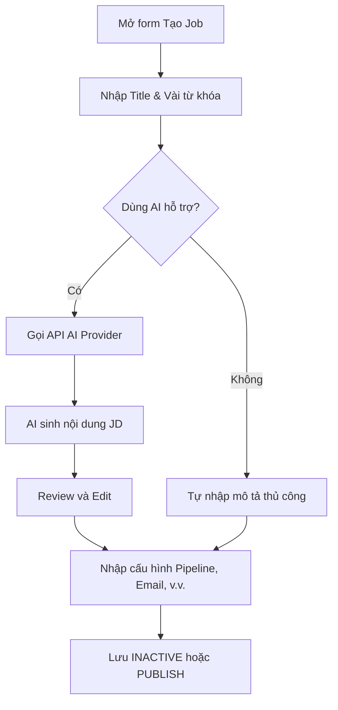

# 📋 User Story 12: Tạo Job Với AI Gợi Ý (Tạo Job with AI JD)

### Quy ước hiển thị dữ liệu Job (22/10/2026)

- Bước xem trước, Job Detail HR và Job Detail công khai dùng cùng nhãn cấp độ kinh nghiệm. Có cấp độ nhưng chưa nhập số năm vẫn hiển thị cấp độ; không suy ra “Không yêu cầu” từ dữ liệu thiếu. Số năm bằng `0` là giá trị có chủ đích, không phải thiếu dữ liệu.
- Chỉ hiển thị “Thỏa thuận” khi `salaryNegotiable = true`. Nếu chưa có cả hai cận lương và không chọn thỏa thuận, hiển thị “Chưa cập nhật”. Một cận lương vẫn được hiển thị bằng “Từ”/“Đến”.
- Chưa có cả cấp độ và số năm kinh nghiệm: “Chưa cập nhật”. Đây là quy tắc hiển thị, không nới lỏng validation publish, không đổi API/DB.

## 1. MÔ TẢ USER STORY
- **Là** Nhà tuyển dụng (HR),
- **Tôi muốn** tạo một tin tuyển dụng (Job) mới và sử dụng AI để tự động viết Mô tả công việc (JD - Job Description) dựa trên một vài từ khóa,
- **Để** tôi có thể tiết kiệm thời gian soạn thảo JD mà vẫn có một tin tuyển dụng chuyên nghiệp, đầy đủ ý.
- **Story Points:** 5

## SƠ ĐỒ LUỒNG NGHIỆP VỤ (Business Flow)

## 2. TIÊU CHÍ NGHIỆM THU (Acceptance Criteria)

- Regression22/10/2026: bước đầu wizard phải có ô `Danh mục công việc` bắt buộc, lấy từ `GET /api/v1/job-categories` (chỉ ACTIVE/chưa xóa), gửi ID vào `categoryId`. Không tự chọn ngầm danh mục hoặc chỉ validate một field không có control nhập. Tải lỗi có thông báo/thử lại, danh sách rỗng không cho lưu/publish; lựa chọn giữ nguyên khi chuyển bước. Backend vẫn kiểm tra category cuối cùng, không dựa riêng validation UI.
- Cảnh báo rời trang chỉ áp dụng thay đổi chưa lưu. Khi create/publish đã trả thành công thì chuyển thẳng đến Job vừa tạo, không hiển thị cảnh báo mất dữ liệu, không yêu cầu bấm Lưu/Đăng tuyển lần nữa. Khi request thất bại vẫn giữ form và guard chưa lưu.

- **Kịch bản 1: HR điền thông tin cơ bản để tạo Job**
  - **VỚI ĐIỀU KIỆN** HR đang ở `/dashboard/jobs` và nhấn "Tạo mới".
  - **KHI** HR điền các trường bắt buộc: Tiêu đề công việc, Vị trí (Location), Mức lương (Min - Max), Loại hình (Full-time/Part-time), Danh mục (Category).
  - **THÌ** các trường này được lưu lại và HR có thể di chuyển xuống phần Mô tả công việc (JD).

- **Kịch bản 2: HR sử dụng AI để tạo JD**
  - **VỚI ĐIỀU KIỆN** HR đang ở màn hình tạo Job, phần Mô tả công việc (Rich Text Editor).
  - **KHI** HR nhập vài từ khóa vào ô "Gợi ý AI" (ví dụ: "ReactJS, 2 năm kinh nghiệm, tiếng Anh cơ bản") và nhấn "Tạo bằng AI".
- **THÌ** hệ thống gọi API LLM (OpenAI/Gemini). Hiển thị loading spinner. Sau đó trả về một đoạn JD hoàn chỉnh (có cấu trúc: Trách nhiệm, Yêu cầu, Quyền lợi) và tự động điền vào Rich Text Editor.

> **Phạm vi contract hiện tại:** luồng tạo Job thủ công và liên kết category đã được triển khai. AI JD Writer chỉ được nối khi provider, secret/config và API contract được chốt; không dùng mock response trong backend.

- **Kịch bản 3: HR chỉnh sửa nội dung AI tạo ra**
  - **VỚI ĐIỀU KIỆN** AI đã tạo xong nội dung JD trong editor.
  - **KHI** HR chỉnh sửa thủ công (thêm, bớt chữ, đổi format).
  - **THÌ** trình soạn thảo hoạt động bình thường, ghi nhận các thay đổi của HR.

- **Kịch bản 4: HR lưu nháp (Save Draft)**
  - **VỚI ĐIỀU KIỆN** HR đã điền một phần thông tin nhưng chưa muốn Publish.
  - **KHI** HR nhấn "Lưu nháp".
  - **THÌ** hệ thống lưu dữ liệu vào bảng `jobs` với `status = INACTIVE`. Đây là trạng thái chưa công khai/bản nháp theo database và code hiện tại. HR được đưa về danh sách Job.

- **Kịch bản 5: Lỗi kết nối AI**
  - **VỚI ĐIỀU KIỆN** AI generation service hiện không khả dụng.
  - **KHI** HR nhấn "Tạo bằng AI".
- **THÌ** hệ thống hiển thị thông báo thân thiện: _"Dịch vụ AI hiện không khả dụng. Vui lòng thử lại hoặc tiếp tục nhập JD thủ công."_ Trình soạn thảo vẫn khả dụng để gõ thủ công và giữ nguyên dữ liệu HR đã nhập.

- `POST /api/v1/jobs` nhận cùng lúc thông tin Job, `formFields`, `rounds` và `publish` (Boolean, mặc định false). Tạo Job và dữ liệu con trong cùng transaction. `publish=true` kiểm tra đầy đủ điều kiện publish rồi trả HTTP 201 với Job ACTIVE; nếu thất bại thì rollback toàn bộ, không giữ draft mồ côi. Form giữ dữ liệu để HR sửa và gửi lại. Quyết định rollback đã được xác nhận ngày 20/10/2026.
- `publish=false` hoặc bỏ qua: tạo INACTIVE. Không tự gán categoryId=1. Round có PASS/FAIL template bắt buộc; cho phép danh sách rounds rỗng. Việc gửi câu trả lời thuộc US-26.
- Số vòng phỏng vấn là tùy chọn: Job không cần phỏng vấn được phép có `roundCount = 0`; mọi giá trị âm đều không hợp lệ. Job mới bắt đầu với `round_count = 0` và có thể publish khi thỏa các điều kiện publish khác, dù chưa cấu hình pipeline.

## 3. NGOÀI PHẠM VI
- **KHÔNG** hỗ trợ AI tự động dịch JD sang nhiều ngôn ngữ cùng lúc.
- **KHÔNG** có tính năng "Chat" liên tục với AI để chỉnh sửa từng đoạn nhỏ (chỉ tạo một lần dựa trên prompt).
