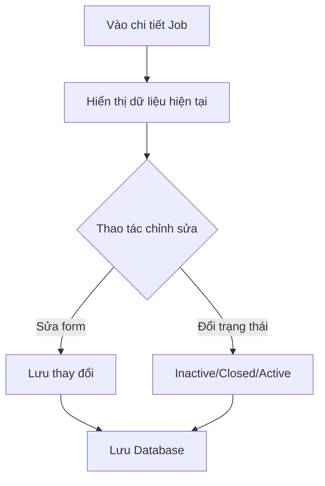

# 📋 User Story 13: Xem & Chỉnh Sửa Job (View & Edit Job)

## 1. MÔ TẢ USER STORY

Đồng bộ bảo vệ workspace 21/10/2026: toàn bộ API `/api/v1/jobs` (gồm list/stats/detail và thao tác ghi) chỉ dành cho HR/HR_ADMIN có User ACTIVE và Company ACTIVE, backend re-check từ database. PENDING/REJECTED/BLOCKED không được đọc dữ liệu workspace bằng token cũ; các API public Career Site dùng controller riêng và không bị biến thành yêu cầu đăng nhập.
- **Là** Nhà tuyển dụng (HR),
- **Tôi muốn** xem lại thông tin chi tiết của một tin tuyển dụng đã tạo và chỉnh sửa nó khi cần thiết,
- **Để** tôi có thể cập nhật nội dung JD, thay đổi mức lương hoặc ngày hết hạn nếu có sự thay đổi từ yêu cầu tuyển dụng.
- **Story Points:** 3

## SƠ ĐỒ LUỒNG NGHIỆP VỤ (Business Flow)

## 2. TIÊU CHÍ NGHIỆM THU (Acceptance Criteria)

- **Kịch bản 1: HR xem chi tiết Job**
  - **VỚI ĐIỀU KIỆN** HR đang ở danh sách Job.
  - **KHI** HR click vào tiêu đề của một Job hoặc chọn "Chỉnh sửa" từ menu.
  - **THÌ** hệ thống chuyển đến màn hình `/dashboard/jobs/{job_id}` hiển thị đầy đủ thông tin hiện tại của Job; thao tác "Chỉnh sửa" mở modal chỉnh sửa trên cùng màn hình (có thể mở trực tiếp bằng query `?edit=true`).

  - **KHI** HR click vào "Xem danh sách vòng" trong widget Vòng phỏng vấn.
  - **THÌ** hệ thống hiển thị một popup chứa danh sách các vòng tuyển dụng. Danh sách này chỉ để xem (read-only), không được phép chỉnh sửa.

- **Kịch bản 2: HR chỉnh sửa và lưu thành công**
  - **VỚI ĐIỀU KIỆN** HR đang ở màn hình chỉnh sửa Job.
  - **KHI** HR thay đổi một số thông tin (ví dụ: mô tả, ngày hết hạn) và nhấn "Cập nhật".
- **THÌ** hệ thống gọi API `PUT /api/v1/jobs/{job_id}`, validate dữ liệu và cập nhật database.

- **KHI** HR mở form chỉnh sửa Job
- **THÌ** hệ thống tải danh mục từ `GET /api/v1/job-categories`; chỉ category `ACTIVE` và chưa xóa mềm được chọn cho thay đổi mới.
- **VÀ** nếu category cũ đã `INACTIVE`, hệ thống vẫn hiển thị quan hệ hiện tại và giữ nguyên nếu HR không chọn category khác.
- **VÀ** sau khi cập nhật thành công, hiển thị toast thông báo "Cập nhật thành công!".
- `roundCount` dùng số nguyên không âm; `roundCount = 0` là hợp lệ cho Job không có vòng phỏng vấn. Khi Edit Job không có vòng nào, request vẫn được lưu thành công và không được báo lỗi tối thiểu một vòng.

- **Kịch bản 3: HR chỉnh sửa Job đang ACTIVE**
  - **VỚI ĐIỀU KIỆN** Job đang có trạng thái `ACTIVE` (đã hiển thị công khai).
  - **KHI** HR chỉnh sửa và lưu lại.
  - **THÌ** thông tin trên trang Career Site thay đổi ngay lập tức (không cần unpublish). Cảnh báo nhỏ xuất hiện báo cho HR biết thay đổi sẽ hiển thị public ngay.

- **Kịch bản 4: HR cố gắng chỉnh sửa Job đã CLOSED**
  - **VỚI ĐIỀU KIỆN** Job đang có trạng thái `CLOSED`.
  - **KHI** HR mở trang chỉnh sửa.
  - **THÌ** toàn bộ form ở trạng thái "Chỉ đọc" (không thể sửa). Nút "Cập nhật" bị ẩn. Hiển thị thông báo: _"Job này đã đóng, không thể chỉnh sửa."_

## 3. NGOÀI PHẠM VI
- **KHÔNG** theo dõi lịch sử chỉnh sửa (version history) của Job – chỉ lưu dữ liệu mới nhất.
- Chỉnh sửa Form ứng tuyển thuộc US-15 và dùng các endpoint `form-fields` riêng; form được chỉnh khi Job `INACTIVE` hoặc `ACTIVE`, còn Job `CLOSED` chỉ đọc và trả `409` nếu có request mutation. Cấu hình Pipeline thuộc User Story riêng.

## Contract cập nhật ngày 20/10/2026

Bổ sung 21/10/2026: Job detail trả `allowedActions` là mảng `EDIT`, `EDIT_PIPELINE`, `PUBLISH`, `CLOSE`, `REOPEN`, `DELETE` khả dụng sau kiểm tra ACTIVE workspace/ownership. INACTIVE cho edit/pipeline và publish nếu đủ điều kiện; ACTIVE cho edit/pipeline/close; CLOSED chỉ reopen nếu đủ điều kiện. DELETE chỉ khi không ACTIVE và chưa có Application. Unknown/deleted không có action. Metadata không thay thế authorization/validation của endpoint; có thể thay đổi sau khi client đọc nên server vẫn re-check. Wire/DB giữ INACTIVE/ACTIVE/CLOSED; không tự chuyển cột String hoặc thêm DRAFT. `canPublish` hiện hành vẫn bao gồm khả năng mở lại CLOSED để tương thích.

- `PUT /api/v1/jobs/{id}` giữ ngữ nghĩa cập nhật từng phần hiện hành: title không bắt buộc nếu không đổi. Omitted giữ nguyên; gửi title rỗng trả 400. Đổi yêu cầu CV chỉ cần `{ "requiresCv": false }`.
- Detail trả `canPublish` và `publishBlockers` (danh sách mã trường thiếu). Backend là nơi kiểm tra cuối; frontend chỉ hiển thị hướng dẫn. `aiMatchingRequeued` phản ánh việc backend thực sự đưa lại vào queue khi nội dung phục vụ matching thay đổi.
- Dropdown chọn Job dùng `GET /api/v1/jobs/options` trả toàn bộ option id/title/status chưa xóa trong tenant, không dùng trang đầu limit=100. Bộ lọc danh sách ứng viên đồng bộ `?jobId=`.
- Pagination hiện hành giữ page/limit, limit tối đa 100. Job cho sort createdAt/title/publishedAt/id; tên field khác bị bỏ qua và dùng createdAt DESC. Không đổi toàn bộ response wrapper/keyword trong đợt sửa này.
- Chuẩn hóa 21/10/2026: giữ API riêng để tương thích; `PUT /jobs/{id}/pipeline` điều phối transaction Job + rounds + form, tái sử dụng cùng rule/configurator/service như CRUD riêng. Omitted formFields giữ nguyên; rounds rỗng là zero-round hợp lệ. Không bỏ roundCount/clearFields hoặc đổi schema như một phần refactor; kiểm tra backend vẫn bắt buộc dù frontend đã có metadata/validation.
