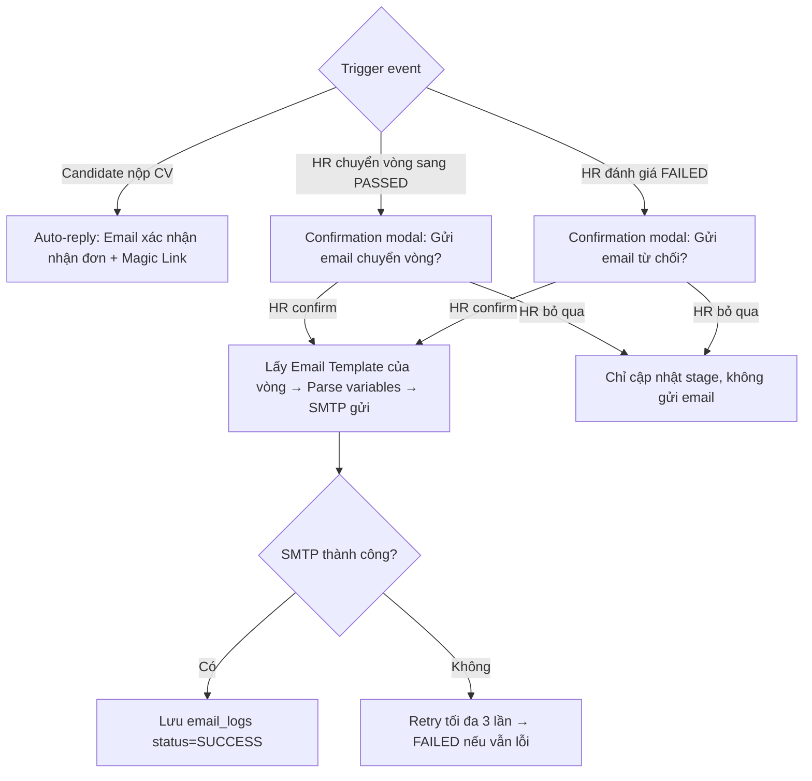

# 📋 User Story 17: Email Automation (Tự Động Hóa Gửi Email)

## 1. MÔ TẢ USER STORY
- **Là** Nhà tuyển dụng (HR),
- **Tôi muốn** hệ thống tự động gửi các email chuẩn hóa đến ứng viên khi có sự thay đổi trạng thái (chuyển vòng, PASSED/FAILED),
- **Để** tôi không phải viết email thủ công, đảm bảo ứng viên luôn được thông báo kịp thời, tăng trải nghiệm ứng viên (Candidate Experience).
- **Story Points:** 5

## SƠ ĐỒ LUỒNG NGHIỆP VỤ (Business Flow)

## 2. TIÊU CHÍ NGHIỆM THU (Acceptance Criteria)

- **Kịch bản 1: Kích hoạt email tự động khi chuyển vòng**
  - **VỚI ĐIỀU KIỆN** HR đã cấu hình `hiring_rounds` cho Job, và mỗi vòng có gắn một Email Template cụ thể.
  - **KHI** HR kéo-thả ứng viên sang vòng tiếp theo trên Kanban Board và vòng đó có gắn Email Template.
  - **THÌ** hệ thống hiển thị **Confirmation Modal**: _"Gửi email thông báo chuyển vòng đến [tên ứng viên]? Template: [tên template]"_ với 2 nút: **"Gửi Email & Cập nhật"** / **"Chỉ Cập nhật"**.
  - Nếu HR chọn "Gửi Email & Cập nhật": Background Job được kích hoạt:
    - Lấy thông tin Email Template tương ứng.
    - Parse các biến nội suy theo catalog API: `{{Candidate.name}}`, `{{Job.title}}`, `{{Company.name}}`, `{{Interview.round}}` thành dữ liệu thực tế.
    - Gọi dịch vụ SMTP (qua Mailtrap/SendGrid) để gửi email đến địa chỉ của ứng viên.
    - Lưu một bản ghi vào bảng `email_logs`.
  - Nếu HR chọn "Chỉ Cập nhật": Chỉ cập nhật stage, không gửi email (lưu log với status = SKIPPED).

- **Kịch bản 2: Tự động gửi email khi nhận đơn ứng tuyển mới (Auto-reply)**
  - **VỚI ĐIỀU KIỆN** Job có cấu hình tự động trả lời khi nhận đơn (ví dụ: Template "Xác nhận nhận đơn").
  - **KHI** ứng viên nộp CV thành công qua Career Site.
  - **THÌ** hệ thống tự động gửi email "Xác nhận đã nhận hồ sơ" đến ứng viên, bao gồm Magic Link để họ tự tra cứu.

- **Kịch bản 3: Tự động gửi email thông báo trượt (Reject)**
  - **VỚI ĐIỀU KIỆN** HR đánh dấu ứng viên là `REJECTED` ở một vòng bất kỳ.
  - **KHI** thao tác được lưu thành công.
  - **THÌ** hệ thống tự động gửi email từ chối khéo léo (Template "Thư cảm ơn / Rejection") cho ứng viên.

- **Kịch bản 4: Xử lý lỗi khi gửi email**
  - **VỚI ĐIỀU KIỆN** SMTP server bị lỗi hoặc email ứng viên sai định dạng.
  - **KHI** hệ thống cố gắng gửi email tự động.
  - **THÌ** nếu lỗi mạng/server: Background Job sẽ thử lại (retry) tối đa 3 lần.
  - Nếu vẫn thất bại: bản ghi trong `email_logs` sẽ có `status = FAILED`, HR có thể thấy trên giao diện và thao tác gửi lại sau.

## 3. BUSINESS RULES

### Quy tắc quyết định hồ sơ đã xác nhận (20/10/2026)
- Kết quả vòng lưu riêng ở `application_progress`, khóa `BIGINT`/`Long`; không đồng nhất PASSED với HIRED.
- Đạt vòng chưa phải cuối: ghi PASSED rồi chuyển sang vòng kế tiếp; đạt vòng cuối: giữ Application ACTIVE, chờ HR xác nhận hành động Tuyển riêng.
- Job không cần phỏng vấn (`roundCount = 0`, không có round) vẫn cần HR bấm Tuyển, không tự HIRED.
- Job ACTIVE hoặc CLOSED chưa xóa đều được xử lý hồ sơ đã nhận. CLOSED không mở lại nhận đơn, không cho sửa cấu hình round.
- PASS/FAIL dùng mẫu của **vòng vừa được đánh giá**, không lấy mẫu của vòng kế tiếp. Template bắt buộc khi cấu hình round; không dùng fallback để che template của round bị thiếu/sai tenant/sai loại.
- Các endpoint quyết định hiện hành là `POST /api/v1/applications/{id}/advance`, `/reject`, `/hire`; xem task-be-01. SMTP được xử lý sau commit; lỗi email không hủy kết quả đánh giá.
- Request advance/reject/hire nhận `sendEmail` Boolean tùy chọn, mặc định true. UI xác nhận cho phép bỏ chọn gửi; `false` vẫn ghi quyết định và email log SKIPPED (attemptCount=0), không gọi SMTP. PASS/FAIL template vẫn bắt buộc theo contract cấu hình round.
- Snapshot người nhận/subject/body được lưu vào email_logs trong cùng transaction với quyết định/nộp đơn. Rollback xóa cả email chờ. Worker chỉ thấy bản ghi sau commit và gửi qua SMTP công ty: PENDING → SUCCESS hoặc retry; tối đa 4 lần tổng cộng (1 lần đầu + 3 lần thử lại), backoff mặc định 30/60/90 giây rồi FAILED. SMTP lỗi không rollback hồ sơ.
- Đây là cơ chế at-least-once, không bảo đảm SMTP exactly-once nếu process dừng sau khi SMTP đã nhận nhưng trước khi ghi SUCCESS. SKIPPED không được retry; FAILED thiếu nội dung/người nhận yêu cầu sửa cấu hình, không giả báo gửi thành công.
- Xác nhận nộp đơn dùng template APPLICATION_RECEIVED của company và catalog biến API, gồm Application.trackingLink/trackRequestLink. Seed chỉ tạo khi chưa có template loại này, không thay mẫu hiện có hoặc tự bật lại mẫu đã tắt.
- Tương thích mẫu seed cũ: candidateName/companyName/jobTitle và các alias đã biết vẫn được render; editor mới dùng catalog dạng Candidate.name/Company.name/Job.title. Mẫu xác nhận không có biến tracking được bổ sung link tra cứu cuối email để không làm mất recovery flow. Plaintext legacy được escape trước gửi HTML; biến tùy chọn thiếu được thay rỗng, biến không hỗ trợ còn lại làm email FAILED thay vì gửi placeholder ra ngoài.

### Phân biệt Email Pass Vòng vs Email Mời Phỏng Vấn
- **`pass_email_template_id` (gắn ở `hiring_rounds`):** Dùng cho email thông báo kết quả Đạt vòng (thư chúc mừng chuyển vòng). Gửi khi HR đánh giá PASSED hoặc kéo thẻ sang vòng mới.
- **Email Mời Phỏng Vấn (`INTERVIEW_INVITE`):** Gửi kèm thông tin ngày giờ, hình thức, địa điểm phỏng vấn. Email này **KHÔNG tự động gửi khi vừa chuyển vòng**, mà chỉ được kích hoạt khi HR thực hiện thao tác **Đặt lịch phỏng vấn thành công** ở [US-18](file:///e:/DATN/EasyTech_FE/nghiep_vu/epic-04_Pipeline_Automation/user-story-18_Dat_Lich_Phong_Van/user-story.md).

## 4. NGOÀI PHẠM VI
- **KHÔNG** cho phép ứng viên reply (trả lời) trực tiếp vào email hệ thống và nhận vào inbox của phần mềm (hỗ trợ 1-way email, reply-to sẽ trỏ về email công ty).
- **KHÔNG** cho phép HR custom email nội dung (viết tay hoàn toàn) trong lúc kéo thả – nó phải dùng Template định sẵn.
