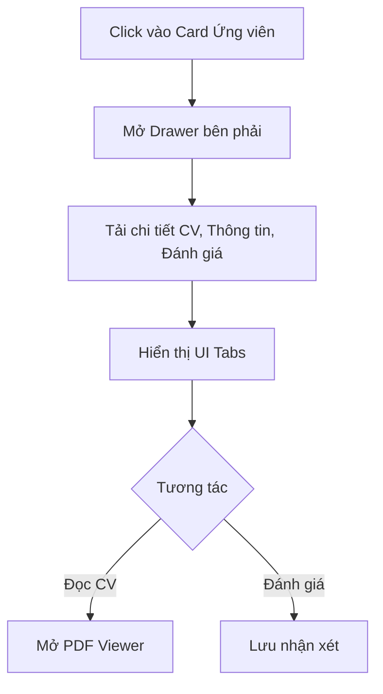

# 📋 User Story 24: Candidate Drawer (Xem Chi Tiết Hồ Sơ Ứng Viên)

### Trạng thái file CV (22/10/2026)

- Khi chi tiết hồ sơ đã tải, xác định có CV theo `cvUrl` của chi tiết; không ưu tiên cờ tóm tắt cũ hơn.
- Không có CV: hiển thị “Chưa có CV”, không hiển thị tên file giả, nhãn PDF hoặc nút xem CV.
- Có CV: hiển thị “CV ứng viên”, định dạng PDF và nút “Xem CV PDF”. API chưa cung cấp tên file gốc nên frontend không tự tạo tên file từ tên ứng viên.
- Giữ nguyên endpoint preview riêng tư, tenant authorization và điều kiện AI scoring: Job yêu cầu CV và hồ sơ thực sự có CV. Không mở quyền xem CV cho Admin.
- Theo xác nhận 22/10/2026, preview trong ứng dụng dùng PDF.js chạy cục bộ thay vì phụ thuộc plugin PDF của browser. Worker/font/cmap/decoder được phục vụ cùng origin; CV không gửi sang dịch vụ ngoài.
- Viewer tải riêng khi mở, hỗ trợ trước/sau và thu phóng, có loading/error/retry và tải PDF. Đóng viewer phải hủy render, giải phóng document/object URL, trả focus về action trước đó. Giữ khóa quyền xem CV ở backend.

## 1. MÔ TẢ USER STORY
- **Là** Nhà tuyển dụng (HR),
- **Tôi muốn** xem chi tiết toàn bộ hồ sơ của ứng viên (CV, Form trả lời, Email History, AI Score) trong một giao diện Drawer mở từ bên phải màn hình,
- **Để** tôi không bị chuyển trang liên tục, có thể thao tác nhanh với ứng viên và giữ nguyên ngữ cảnh của danh sách (Kanban/List).
- **Story Points:** 5

## SƠ ĐỒ LUỒNG NGHIỆP VỤ (Business Flow)

## 2. TIÊU CHÍ NGHIỆM THU (Acceptance Criteria)

- **Kịch bản 1: HR mở xem Drawer của một ứng viên**
  - **VỚI ĐIỀU KIỆN** HR đang ở màn hình Kanban hoặc List View.
  - **KHI** HR click vào một card ứng viên (trên Kanban) hoặc một hàng (trên List).
  - **THÌ** hệ thống trượt Drawer từ bên phải màn hình ra (không reload trang).
  - Drawer hiển thị thông tin tổng quan ở phần Header: Họ tên, Email, Số ĐT, **Application Status** (Active / Rejected / Hired), **Current Stage** (pipeline stage hiện tại), **Latest Round Result** (IN_PROGRESS / PASSED / FAILED nếu có), và Điểm AI (nếu có).
  - **Lưu ý:** Application Status ≠ Current Stage ≠ Round Result. Phải hiển thị rõ 3 thông tin này.

- **Kịch bản 2: HR xem các Tab thông tin trong Drawer**
  - **VỚI ĐIỀU KIỆN** Drawer đang mở.
  - **KHI** HR chuyển đổi qua lại giữa các Tab (Hồ sơ, Đánh giá, Lịch phỏng vấn, Lịch sử Email).
  - **THÌ** hệ thống tải và hiển thị dữ liệu tương ứng của ứng viên đó trong từng tab:
    - Tab **Hồ sơ**: Nút xem PDF CV (in-app preview hoặc tab mới) và câu trả lời các câu hỏi phụ.
    - Tab **Đánh giá**: Form đánh giá và lịch sử.
    - Tab **Lịch phỏng vấn**: Thông tin lịch hẹn.
    - Tab **Email**: Các email đã gửi.

- **Kịch bản 3: HR thực hiện Action từ Drawer**
  - **VỚI ĐIỀU KIỆN** Drawer đang mở.
  - **KHI** HR nhấn vào các nút chức năng:
    - **"Đánh dấu Đạt" (PASSED):** Cập nhật Round Result = PASSED. Nếu không phải vòng cuối → tự động chuyển sang vòng tiếp theo + Confirmation email. Nếu là vòng cuối → Application vẫn ACTIVE, chờ HR nhấn "Tuyển dụng".
    - **"Đánh dấu Trượt" (FAILED):** Hiển thị Confirmation Modal → Sau khi xác nhận: Round Result = FAILED + Application Status = REJECTED + Email từ chối tự động.
    - **"Tuyển dụng" (HIRE):** Chỉ xuất hiện khi ứng viên ở vòng cuối và Round Result = PASSED → Application Status = HIRED + Email chúc mừng.
    - **"Xóa hồ sơ" (Hard Delete):** Hiển thị cảnh báo xác nhận → Xóa vĩnh viễn toàn bộ thông tin ứng viên và file CV.
  - **THÌ** hệ thống xử lý logic tương ứng, hiển thị thông báo thành công và cập nhật lại thông tin hiển thị trên Header của Drawer cũng như trên bảng/kanban bên dưới.

- **Kịch bản 4: HR đóng Drawer**
  - **VỚI ĐIỀU KIỆN** Drawer đang mở.
  - **KHI** HR nhấn nút "X", hoặc click ra ngoài vùng xám (backdrop).
  - **THÌ** Drawer trượt đóng lại, màn hình Kanban/List phía dưới không thay đổi vị trí cuộn ban đầu.

## 3. BUSINESS RULES

### Contract quyết định hồ sơ (20/10/2026)
- Drawer dùng quyền `canEvaluate`/`canHire` và `currentRoundResult` từ API, không tự suy ra điều kiện Tuyển từ số thứ tự vòng.
- Đạt vòng và Tuyển đều có xác nhận; Hủy không gọi API, pending chặn gửi lặp. Refresh danh sách/detail/board sau thành công.
- Job CLOSED vẫn được xử lý hồ sơ cũ. Quy tắc này không cho phép sửa pipeline hoặc nhận đơn mới.
- Với Job không có vòng phỏng vấn, HR được bấm Tuyển trực tiếp; Application vẫn ACTIVE cho đến khi xác nhận.
- Từ chối sau final PASSED giữ nguyên lịch sử PASSED của vòng đã chốt, nhưng Application chuyển REJECTED và lưu lý do/thời điểm. Không tự ghi đè đánh giá đã có.
- Lịch sử cũ không có evaluation record không được suy diễn là PASSED chỉ từ `current_round_id`.
- API detail trả `currentRoundResult` (PENDING/PASSED/FAILED/SKIPPED hoặc null khi không có vòng), `canEvaluate`, `canHire` và `roundHistory[].result`. Trong DB, trạng thái chưa đánh giá chưa cần tạo record PENDING.

### Reject Trigger Rule
- Application Status = REJECTED được set theo 2 con đường:
  1. **Explicit action:** HR nhấn "Đánh dấu Trượt" trong Candidate Drawer → Confirmation Modal → FAILED + REJECTED.
  2. **Auto rule:** Round Result = FAILED (từ Kanban drag hoặc Drawer) → tự động set Application Status = REJECTED.
- Cả 2 con đường đều trigger Email Automation gửi email từ chối nếu HR confirm trong modal.
- KHÔNG cho phép drag card trực tiếp sang cột "Rejected" mà bỏ qua Round Result (phải đi qua FAILED evaluation).

## 4. NGOÀI PHẠM VI
- **KHÔNG** có tính năng "Preview PDF" trực tiếp nhúng vào Drawer nếu trình duyệt không hỗ trợ iframe PDF chuẩn (chấp nhận mở tab mới).
- **KHÔNG** hỗ trợ tính năng Chat trực tuyến với ứng viên trong Drawer.
