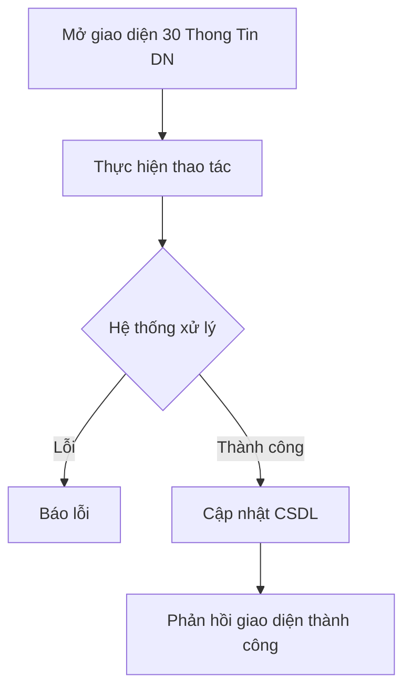

# 📋 User Story 30: Thông Tin Doanh Nghiệp (Company General Settings)

## 1. MÔ TẢ USER STORY
- **Là** Nhà tuyển dụng (HR Admin),
- **Tôi muốn** cập nhật thông tin liên hệ và địa chỉ doanh nghiệp trong hệ thống,
- **Để** dữ liệu công ty luôn chính xác, các báo cáo hoặc hóa đơn hiển thị đúng thông tin, và cài đặt hệ thống phù hợp với khu vực hoạt động.
- **Story Points:** 2

## SƠ ĐỒ LUỒNG NGHIỆP VỤ (Business Flow)

## 2. TIÊU CHÍ NGHIỆM THU (Acceptance Criteria)

- **Kịch bản 1: HR Admin xem và cập nhật thông tin công ty**
  - **VỚI ĐIỀU KIỆN** HR có quyền Admin truy cập `/dashboard/settings/general`.
  - **KHI** form hiển thị thông tin hiện tại. HR Admin sửa địa chỉ chi tiết, tỉnh/thành phố, xã/phường, số điện thoại hoặc website rồi nhấn "Lưu thay đổi".
  - **THÌ** hệ thống xác thực dữ liệu, gọi API `PATCH /api/v1/company-profiles/me`, cập nhật database và hiển thị thông báo "Cập nhật thành công".
  - Sau khi onboarding hoàn tất, đây là allowlist duy nhất của request PATCH: `phone`, `address`, `provinceCode`, `wardCode`, `website`. Backend từ chối request có chứa field hồ sơ khác.
  - Tên công ty, mã số thuế, ngành nghề, quy mô, mô tả, slogan, loại hình, năm thành lập, thông tin thương hiệu và logo/ảnh bìa chỉ hiển thị read-only trong trang này; không nằm trong request PATCH.
  - HR Admin là vai trò duy nhất được phép lưu thay đổi. HR không có quyền Admin chỉ xem hồ sơ và không được gọi thành công API cập nhật.
  - Các thông tin mới hiển thị ngay lập tức trên giao diện chung của Dashboard.
  - Địa chỉ chi tiết (số nhà, tên đường, ngõ...) do HR nhập và lưu riêng ở `companies.address`; không tự ghép tên xã/phường hoặc tỉnh/thành phố vào trường này.
  - HR chọn tỉnh/thành phố và xã/phường từ dữ liệu `full_json_generated_data_vn_units.json`. Hệ thống lưu mã lựa chọn riêng vào `companies.province_code` và `companies.ward_code`; hai mã phải được gửi cùng nhau hoặc cùng để trống, và xã/phường phải thuộc tỉnh/thành phố đã chọn.
  - Dữ liệu legacy có thể vẫn chứa địa giới trong `companies.address`; không tự phân tích/chuyển đổi chuỗi cũ vì không đảm bảo chính xác. Khi chỉnh sửa, HR có thể sửa địa chỉ chi tiết và chọn lại địa giới.

- **Kịch bản 2: Giới hạn field cập nhật sau onboarding**
  - **VỚI ĐIỀU KIỆN** hồ sơ onboarding đã hoàn tất.
  - **KHI** client gửi `PATCH /api/v1/company-profiles/me` kèm field ngoài allowlist ở Kịch bản 1, hoặc HR gửi request cập nhật.
  - **THÌ** backend từ chối field ngoài allowlist bằng `400` và từ chối HR không có quyền Admin bằng `403`; không ghi dữ liệu thay đổi.
  - Thay đổi logo/ảnh bìa không thuộc trang General Settings sau onboarding; luồng tải logo ban đầu thuộc thiết lập hồ sơ US-03.

- **Kịch bản 3: HR không có quyền Admin cố gắng chỉnh sửa**
  - **VỚI ĐIỀU KIỆN** HR (không có quyền Admin) truy cập trang này.
  - **KHI** trang hiển thị.
  - **THÌ** form hiển thị ở chế độ Chỉ đọc (chỉ xem), nút "Lưu thay đổi" và tính năng upload logo bị ẩn.

- **Kịch bản 4: Field đăng ký chỉ đọc**
  - **VỚI ĐIỀU KIỆN** HR Admin xem thông tin doanh nghiệp.
  - **KHI** xem hoặc gửi request sửa tên doanh nghiệp/MST từ trang này.
  - **THÌ** tên doanh nghiệp và MST vẫn read-only; API hồ sơ không cho cập nhật hai field đăng ký này.

## 3. NGOÀI PHẠM VI
- **KHÔNG** quản lý thông tin xuất hóa đơn đỏ (VAT Invoicing) chi tiết trong phiên bản MVP này.
- **KHÔNG** liên kết thay đổi tên công ty với các thông tin đã public trên Career Site (nếu thay đổi, phải chỉnh sửa ở trang Career Site Settings riêng).
