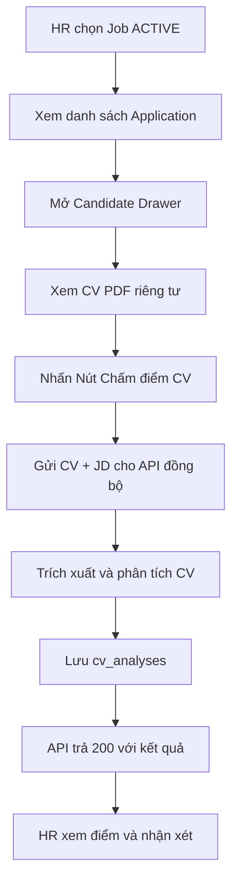

# 📋 User Story 34: CV Scoring & Insights (AI Chấm Điểm CV Tự Động)

## 1. MÔ TẢ USER STORY
- **Là** Nhà tuyển dụng (HR),
- **Tôi muốn** chủ động yêu cầu AI phân tích CV của ứng viên và đánh giá độ phù hợp so với Job Description (JD),
- **Để** tôi có thêm thông tin tham khảo khi screening mà không phải đọc thủ công từng CV ngay từ đầu.
- **Story Points:** 5

## SƠ ĐỒ LUỒNG NGHIỆP VỤ (Business Flow)

## 2. TIÊU CHÍ NGHIỆM THU (Acceptance Criteria)

- **Kịch bản 1: HR chủ động chấm điểm CV**
  - **VỚI ĐIỀU KIỆN** HR đã chọn Job có trạng thái `ACTIVE`, ứng viên vừa nộp đơn thành công và CV dạng PDF được lưu trong Storage.
  - **KHI** HR mở Candidate Drawer, có thể xem CV PDF, rồi nhấn "Chấm điểm AI".
  - **THÌ** frontend gọi `POST /api/v1/applications/{applicationId}/cv-analysis`; backend kiểm tra company ownership, đọc CV, lấy JD hiện tại và gọi provider đã resolve.
  - Đây là request **đồng bộ**: API giữ request trong lúc xử lý và chỉ trả `200 OK` sau khi kết quả đã được lưu vào `cv_analyses`. Không kích hoạt khi Application vừa được tạo, không dispatch background worker/queue và không dùng `202 Accepted` trong MVP.
  - UI hiển thị loading, sau đó hiển thị Matching Score, điểm mạnh, điểm yếu, kỹ năng khớp/thiếu và summary.

- **Kịch bản 1a: Job không yêu cầu CV**
  - **VỚI ĐIỀU KIỆN** Job có `requiresCv = false`.
  - **THÌ** Candidate Drawer không hiển thị nút hoặc khu vực chấm điểm AI; backend từ chối request trực tiếp tới endpoint với `422` để bảo vệ cùng một contract.
  - Nếu Application có CV tùy chọn, CV vẫn có thể được lưu để phục vụ nghiệp vụ khác, nhưng không làm Job đủ điều kiện chấm điểm AI.

- **Kịch bản 2: HR xem chi tiết CV Insights**
  - **VỚI ĐIỀU KIỆN** API đã trả về kết quả thành công.
  - **KHI** HR mở Candidate Drawer của ứng viên đó.
  - **THÌ** phần "AI Insights" hiển thị kết quả phân tích mới nhất từ `cv_analyses`, gồm đồ thị / thanh đo điểm số (Matching Score).
  - Phía dưới hiển thị bullet points rõ ràng: "Điểm mạnh (Khớp JD)", "Điểm yếu (Thiếu sót so với JD)" và "Nhận xét tổng quan của AI".
  - AI không tự đổi Application Status, Pipeline Stage hoặc Round Result.

- **Kịch bản 2a: HR xem CV trước khi chấm điểm**
  - **VỚI ĐIỀU KIỆN** Application thuộc Job HR đang quản lý và có `hasCv = true`.
  - **KHI** HR nhấn "Xem CV PDF" trong Candidate Drawer.
  - **THÌ** frontend gọi `GET /api/v1/applications/{applicationId}/cv` và hiển thị PDF qua preview nội bộ; backend không trả public storage URL và không cho company khác hoặc Admin hệ thống đọc CV.

- **Kịch bản 3: Xử lý file CV không thể đọc (Non-parsable)**
  - **VỚI ĐIỀU KIỆN** CV không chứa text hoặc bị hỏng định dạng, hoặc provider không khả dụng.
  - **KHI** HR gọi API chấm điểm.
  - **THÌ** công đoạn trích xuất text/provider thất bại; backend lưu trạng thái lỗi vào `cv_analyses` và API trả lỗi có thể hành động được, không trả `202` giả thành công.
  - UI hiển thị: "AI không thể đọc được nội dung CV này. Vui lòng kiểm tra lại file hoặc chấm thủ công." Kết quả cũ (nếu có) không bị xóa khi lần chạy mới thất bại.

- **Kịch bản 4: HR yêu cầu chấm điểm lại (Re-score)**
  - **VỚI ĐIỀU KIỆN** HR đã cập nhật lại JD của Job, khiến các điểm số cũ không còn chính xác.
  - **KHI** HR nhấn nút "Chạy lại AI Scoring" trên Drawer hoặc chọn hàng loạt ứng viên và chạy lại.
  - **THÌ** Backend thực hiện lại request đồng bộ với JD mới, lưu bản phân tích mới vào `cv_analyses` và chỉ thay kết quả đang hiển thị sau khi lần chạy mới thành công. Không dùng queue trong MVP.

## 3. CONTRACT MVP

- **Endpoint:** `POST /api/v1/applications/{applicationId}/cv-analysis`.
- **Trigger:** on-demand, chỉ do HR chủ động nhấn nút; Application creation không tự gọi AI.
- **Eligibility:** chỉ cho phép khi Job có `requiresCv = true` và Application có CV hợp lệ đã lưu. `requiresCv = false` là trạng thái không đủ điều kiện dù Application có thể có CV tùy chọn.
- **Request:** `{ "rerun": false }` hoặc `{ "rerun": true }`; `applicationId` là PostgreSQL `BIGINT`/Java `Long`.
- **Success:** `200 OK` chỉ được trả sau khi bản ghi phân tích hoàn tất và đã lưu. `202 Accepted` không thuộc contract MVP.
- **Result storage:** bảng `cv_analyses`; mỗi lần chạy có thể lưu một bản ghi mới để giữ lịch sử, UI dùng bản ghi thành công mới nhất.
- **ID:** các ID trong DB là `BIGINT`, Java là `Long`, JSON/TypeScript là number; không dùng UUID cho contract này.
- **Provider:** resolve theo thứ tự custom provider `ACTIVE` của company → system default → lỗi rõ ràng nếu không có provider khả dụng.
- **Provider retry/fallback:** với mỗi model, backend thử tối đa `AI_RETRY_MAX_ATTEMPTS` lần (mặc định `2`, gồm lần gọi đầu tiên) cho lỗi tạm thời như `408`, `429`, `5xx` hoặc lỗi kết nối, dùng backoff có giới hạn. Khi model chính hết lượt mà vẫn lỗi, backend thử model dự phòng `GEMINI_FALLBACK_MODEL` bằng cùng provider/key và chính sách retry tương tự. Không retry lỗi API key/quyền hoặc request/schema không hợp lệ.
- **Provider failure:** nếu model chính và model dự phòng đều không thành công, API trả `503` với thông báo nêu rõ cả hai model và số lượt thử; lưu bản ghi `FAILED`, không tạo điểm giả và không xóa kết quả `COMPLETED` trước đó.
- **Output:** `id`, `applicationId`, `matchingScore`, `matchedSkills`, `missingSkills`, `strengths`, `weaknesses`, `summary`, `provider`, `providerSource`, `status`.

## 3. NGOÀI PHẠM VI
- **KHÔNG** tự động loại bỏ (Auto-reject) hoặc hire ứng viên nếu điểm thấp – AI chỉ mang tính chất gợi ý, quyết định cuối cùng vẫn thuộc về HR.
- **KHÔNG** phân tích ngôn ngữ cảm xúc hay bias giới tính/độ tuổi (chỉ match hard skills/experience giữa CV và JD).
- **KHÔNG** tự động chấm điểm ngay khi ứng viên nộp CV trong MVP.
